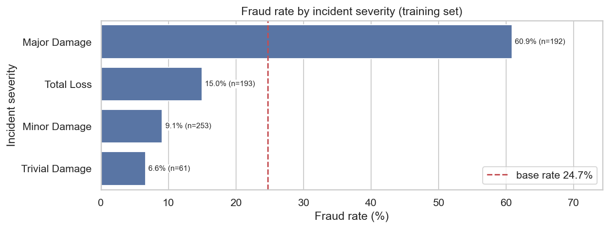
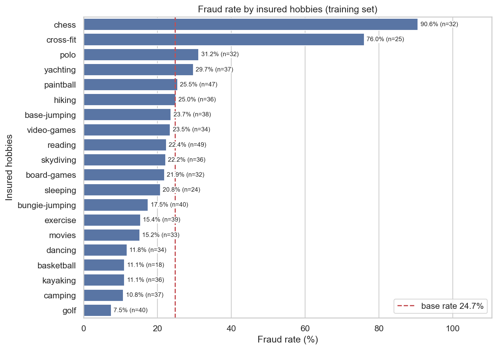
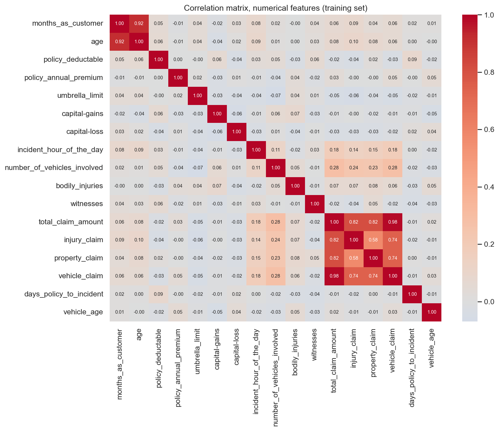
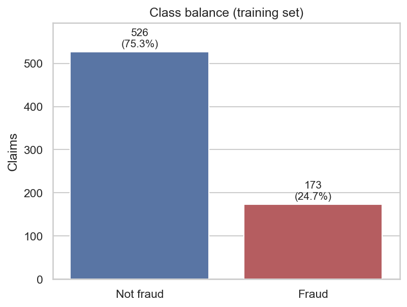
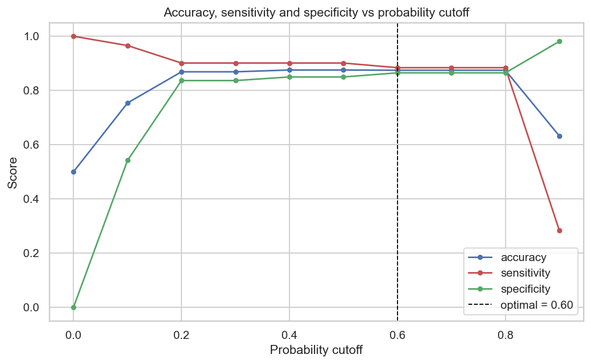
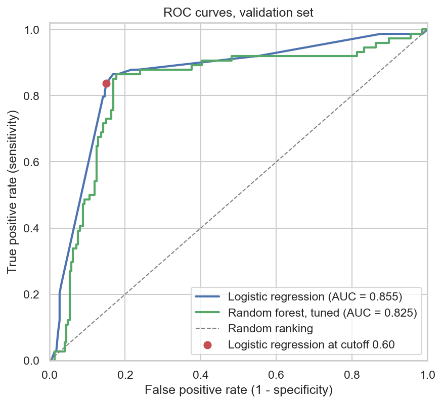
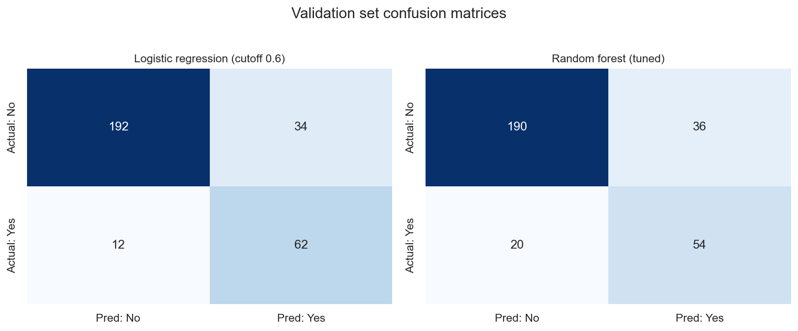

# Fraudulent Claim Detection

Classifying auto insurance claims as fraudulent or legitimate using logistic regression
and random forest, on 1,000 historical claims with a 24.7% fraud rate.

**On held-out claims, logistic regression catches 84% of frauds at 85% specificity
(F1 0.729, AUC 0.855). It beats a tuned random forest on every validation metric, even
though the forest scores 0.982 accuracy on the training set (1.000 before tuning).**

## The problem

An insurer reviewing motor claims has two ways to lose money. Paying a fraudulent claim
costs the payout. Investigating an honest one costs an adjuster's time and irritates a
customer who did nothing wrong. Reviewing every claim is not affordable, so the question
is which claims to look at.

The model's first job is therefore to rank claims by risk, so a small review team can
start at the top. Picking the cutoff on that ranking comes second.

## Data

1,000 claims, 40 columns, covering policy details, the insured party, the incident, and
claim amounts. Target is `fraud_reported` (Y/N), 24.7% positive.

| Step | Rows | Columns |
|---|---|---|
| Raw | 1,000 | 40 |
| After dropping `_c39` (entirely empty) | 1,000 | 39 |
| After dropping one invalid row | 999 | 39 |
| After dropping identifiers, adding derived features | 999 | 35 |
| Train / validation (70/30, stratified) | 699 / 300 | 34 |

### Cleaning decisions

**`authorities_contacted`, 91 nulls.** The other levels are Police, Fire, Ambulance and
Other. In the raw CSV these 91 rows say "None", which pandas reads as missing by default,
so they are claims where no authority was contacted. I filled them as their own category.
Dropping them would have cost 9% of a dataset with only 247 fraud cases to learn from.

**`_c39`, 1,000 nulls.** Trailing-comma artefact from the CSV export. Dropped.

**One claim with `umbrella_limit` = -1,000,000.** A coverage ceiling can't be negative.
I removed the row instead of guessing which sign was intended, since one row in a
thousand isn't worth inventing a value for. `capital-loss` was left out of this check
because it is negative by definition.

**`policy_number`, `incident_location`, `insured_zip`.** One distinct value per row
(994 of 999 for `insured_zip`). A model can memorise these but can't generalise from
them, so they were dropped.

**Dates.** `policy_bind_date` and `incident_date` were converted, used to derive
`days_policy_to_incident` and `vehicle_age`, then dropped. A claim that arrives soon
after a policy starts is a common fraud red flag, so the gap was worth keeping as a
feature.

## What the data says

Fraud rate varies a lot across categorical levels, against a base rate of 24.7%. Ranked
by spread:

| Feature | Highest level | Lowest level | Spread |
|---|---|---|---|
| `insured_hobbies` | 90.6% | 7.5% | 83.1 pts |
| `incident_severity` | 60.9% | 6.6% | 54.3 pts |
| `auto_model` | 43.8% | 0.0% | 43.8 pts |
| `incident_state` | 42.1% | 15.1% | 27.0 pts |
| `authorities_contacted` | 31.6% | 8.8% | 22.8 pts |



Major Damage claims are fraudulent 60.9% of the time (n=192), against 6.6% to 15.0% for
the other three levels. Total Loss, the most severe category, sits at 15.0%, so fraud
does not simply rise with severity.



`insured_hobbies` is stranger. Chess and cross-fit have fraud rates of 90.6% and 76.0%
on 32 and 25 training rows, while every other hobby sits between 7.5% and 31.2%.

Playing chess doesn't make anyone commit insurance fraud. This is almost certainly an
artefact of the synthetic data: the generator leaked label information into that column.
I kept it as one binary `high_risk_hobby` flag instead of nineteen dummy columns because
it is predictive on this data, and it ends up with the largest coefficient in the final
model. It would not carry over to real claims, and a production model should not use it.

### Redundancy

Two redundancies had to be resolved before fitting a linear model:

- `total_claim_amount` is exactly `injury_claim + property_claim + vehicle_claim`
  (verified on every training row; r = 0.984 with `vehicle_claim` alone). Keeping all
  four sends VIF to infinity, so I kept the total, the figure an investigator would quote.
- `months_as_customer` correlates 0.920 with `age`, so `months_as_customer` was dropped.



### Class balance



24.7% of claims are fraudulent. That is enough imbalance to make accuracy misleading:
predicting "not fraud" for every claim scores 75.3% and catches nothing.

The training set was oversampled to 50/50 with `RandomOverSampler`, taking it from 699
to 1,052 rows. The validation set was left at its natural rate, because a metric measured
on a balanced set would not describe how the model behaves on real claim traffic.

## Feature selection

85 columns after one-hot encoding. RFECV with F1 scoring selected 6.

RFECV picks features by predictive score and ignores p-values, so I checked its picks in
statsmodels: drop the least significant feature if its p-value is above 0.05, refit, and
repeat, then do the same for any VIF above 5. Going one feature at a time matters because
each p-value depends on the other features in the model.

None needed removing. The final model has 6 features, a maximum p-value of 0.0463 and a
maximum VIF of 1.20: the hobby flag, three incident-severity levels (Total Loss, Minor
Damage and Trivial Damage, with Major Damage as the baseline), the handlers-cleaners
occupation and a grouped "other" car make.

## Choosing the cutoff



Sensitivity and specificity are closest at **0.60**, which is the cutoff used throughout.
With six binary features the model only produces a small set of distinct probabilities, so
cutoffs of 0.6, 0.7 and 0.8 classify every training claim the same way; 0.60 is the
first of the three.

Taking the balance point treats a missed fraud and a wrongly flagged honest claim as
equally costly, and in a real claims operation they aren't. A missed fraud costs the full
payout, while a false flag costs an adjuster's time and some goodwill. An insurer who knew
both costs would move the cutoff, and this curve is what they would use to do it.



## Results

### Training set (oversampled to 1,052 rows)

| Model | Accuracy | Sensitivity | Specificity | Precision | F1 |
|---|---|---|---|---|---|
| Logistic regression, cutoff 0.5 | 0.875 | 0.901 | 0.850 | 0.857 | 0.879 |
| Logistic regression, cutoff 0.60 | 0.875 | 0.884 | 0.865 | 0.868 | 0.876 |
| Random forest, tuned | 0.982 | 0.998 | 0.966 | 0.967 | 0.982 |

### Validation set (300 claims, natural 24.7% fraud rate)

| Model | Accuracy | Sensitivity | Specificity | Precision | F1 | AUC |
|---|---|---|---|---|---|---|
| **Logistic regression** | **0.847** | **0.838** | **0.850** | **0.646** | **0.729** | **0.855** |
| Random forest (tuned) | 0.813 | 0.730 | 0.841 | 0.600 | 0.659 | 0.825 |



In claim terms: of 74 fraudulent claims in the validation set, logistic regression caught
62 and missed 12. Of the 96 claims it flagged, 34 were honest claims sent for review.

## Findings

**The random forest overfits.** It scores 1.000 on every training metric before tuning
and 0.982 accuracy after, then drops to 0.813 accuracy and F1 0.659 on validation, below
the logistic regression on all six measures. Grid search chose `max_depth=10` and
`min_samples_leaf=1` (the grid also offered depths of 6 and unlimited, and leaf sizes of
3 and 5), and trees that size still fit the oversampled training set almost perfectly.

**The cross-validated scores are inflated.** Cross-validation on the oversampled training
set gave F1 = 0.921 ± 0.005. Oversampling duplicates minority rows before the data is
split into folds, so copies of the same claim end up in a training fold and in the fold
used to test it. The validation set was never resampled, which makes it the only honest
estimate here. The fix is to resample inside each fold.

**The simpler model won, probably because the dataset is small.** With 699 training rows
and 173 fraud cases, six significant coefficients generalised better than 200 depth-10
trees trained on 18 features.

**Part of the signal is an artefact.** `high_risk_hobby` has the largest coefficient and
comes from a leak in the data generator, so performance would likely fall a long way
without it. The validation numbers above overstate what this model would do on real
claims.

## Limitations

- 1,000 rows and 247 fraud cases, so every validation metric has a wide confidence
  interval.
- The data is synthetic and contains leaked label information. It can demonstrate the
  method but can't estimate real fraud-detection performance.
- Oversampling before cross-validation inflates the CV-based scores in the notebook
  (RFECV, the cross-validation check and the grid search).
- The split is random. In production you predict future claims from past ones, so a
  time-ordered split would be a harder and fairer test.
- Impurity-based feature importance favours high-cardinality and continuous features, so
  the random forest ranking is not directly comparable to the logistic coefficients.

## Next steps

- Resample inside each CV fold (`imblearn.pipeline.Pipeline`) so the cross-validated
  scores mean something
- Refit without `high_risk_hobby` to see how much of the performance is real
- Set the threshold from costs once the relative cost of a missed fraud and a false flag
  is known
- Try gradient boosting with explicit depth limits, between the two models tried here
- Check calibration, since a risk score that feeds a review queue should be a probability
  an operator can reason about

## Running it

```bash
pip install -r requirements.txt
jupyter notebook Fraudulent_Claim_Detection_Shubham_Kumar_Singh.ipynb
```

`insurance_claims.csv` came with the course and is not included in this repo; it needs to
be in the same directory as the notebook. Run all cells top to bottom, since later cells
depend on earlier state.

---

**Shubham Kumar Singh**, MSc Artificial Intelligence and Computer Science, Northeastern University London

Originally completed as a case study in the upGrad and IIIT Bangalore Data Science Programme.

[LinkedIn](https://linkedin.com/in/shubham-singh-00236a191) · [GitHub](https://github.com/Shubham-afk-del)
